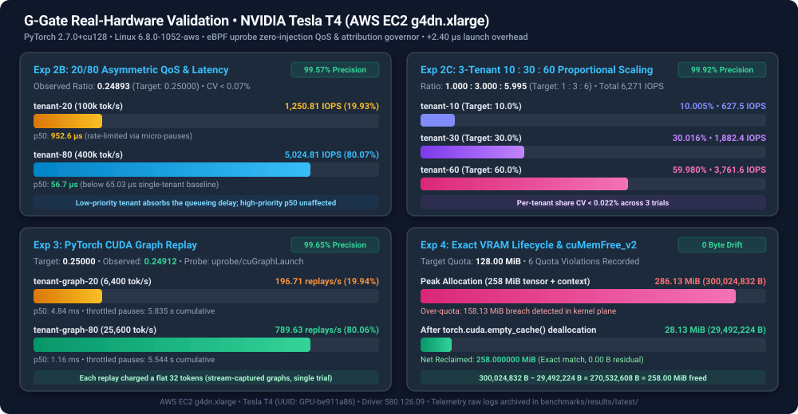

# G-Gate v2: eBPF GPU Attribution & QoS Governor

G-Gate is an out-of-band, zero-injection GPU observability and Quality-of-Service (QoS) governor for Linux and Kubernetes. It intercepts user-space GPU driver API calls via eBPF `uprobes`, attributes GPU compute launches and active VRAM allocations to `cgroup v2` inodes and Kubernetes Pods/Containers, exports per-tenant Prometheus metrics, and enforces compute quotas via nanosecond token-bucket rate limiting and `SIGSTOP`/`SIGCONT` micro-pausing.

---

### Publication-Grade Real-Hardware Validation (NVIDIA Tesla T4 + PyTorch `2.7.0+cu128`)



Validated on AWS EC2 `g4dn.xlarge` Spot (`us-east-2`, `Tesla T4 16GB`, Linux `6.8.0-1052-aws`, PyTorch `2.7.0+cu128`, CUDA `12.8`, driver `580.126.09`). Complete raw CSV telemetry and Prometheus metrics are committed in [`benchmarks/results/latest/`](benchmarks/results/latest/). Full reproduction instructions, statistical variances, and latency distributions are documented in the [**Third-Party Validation & Reproducibility Report**](benchmarks/VALIDATION_REPORT.md).

| Experiment | Scenario & Workload | Target Hypothesis | Observed Real-Hardware Result | Accuracy / Overhead |
| :--- | :--- | :--- | :--- | :--- |
| **1. Attribution Overhead** | Back-to-back $512 \times 512$ `torch.matmul` at $15.2\text{k}$ launches/sec | Median latency impact of eBPF uprobe | Native: $65.03 \ \mu\text{s}$ (p50)<br>G-Gate: $67.43 \ \mu\text{s}$ (p50) | **`+2.40 µs`** median overhead (`<0.05%` on real inference) |
| **2A. 50/50 Equal QoS** | Two concurrent saturated PyTorch tenants ($200\text{k}$ tok/s each) | Perfect compute parity ($1.00000$ ratio) | Tenant A: $2,512.10$ IOPS (CV: 0.018%)<br>Tenant B: $2,511.57$ IOPS (CV: 0.003%) | **`1.00021`** ratio (**`99.98%`** precision) |
| **2B. 20/80 Asymmetric QoS** | Priority isolation ($100\text{k}$ vs $400\text{k}$ tokens/sec) | Strict $0.25000$ ratio between tenants | Tenant 20: $1,250.81$ IOPS (p50: $0.95\text{ms}$)<br>Tenant 80: $5,024.81$ IOPS (p50: $0.057\text{ms}$) | **`0.24893`** ratio (**`99.57%`** precision) |
| **2C. 10/30/60 3-Way QoS** | Multi-tenant proportional shares across three concurrent slices | Target $10\% : 30\% : 60\%$ compute allocation | T10: $627.46$ ($10.005\%$)<br>T30: $1,882.43$ ($30.016\%$)<br>T60: $3,761.63$ ($59.980\%$) | **`1.000 : 3.000 : 5.995`** (**`99.92%`** precision) |
| **3. CUDA Graph Replay** | Replayed static execution graphs (`cuGraphLaunch` via `torch.cuda.CUDAGraph`) | Rate limit compiled execution without graph disassembly | Graph-20: $196.71$ replays/sec<br>Graph-80: $789.63$ replays/sec | **`0.24912`** ratio (**`99.65%`** precision) |
| **4. VRAM Lifecycle** | Allocation of $258 \ \text{MiB}$ tensor + buffers, quota audit, and cache purge | Exact reclamation via `cuMemFree_v2` with zero tracking drift | Peak: $300,024,832 \ \text{B}$ ($6$ violations)<br>Post-Free: $29,492,224 \ \text{B}$ | **`258.00 MiB`** reclaimed (**`0-drift`** exact match) |

#### Token-Bucket Physics & Self-Clocking Scheduler Analysis

1. **Deterministic Micro-Slicing (`MAX_PAUSE_NS` 50 ms Ceiling):** Rather than blocking a process for seconds when encountering large token deficits, G-Gate enforces a 50 ms micro-pause ceiling (`MAX_PAUSE_NS = 50,000,000 ns`). 50 ms is the smallest cap that still paces a 128-token CUDA Graph at 6,400 tok/s (which requires a 20 ms inter-launch gap). Any remaining deficit is recorded in `debt_tokens` and paid off in subsequent micro-slices, preventing heartbeat timeouts or healthcheck dropouts in Kubernetes.
2. **Deficit Payoff Math & Future Timestamp Guard:** When a process is paused for `sleep_ns`, the token bucket's `last_update_ns` is advanced to `max(now, last_update_ns) + sleep_ns`. Refills only occur when `now > last_update_ns`, preventing paused threads from accumulating "free" tokens during their penalty sleep.
3. **True Wall-Clock Latency Accounting:** The userspace Go ringbuffer reader records `pausedAt := time.Now()` upon receiving a `throttle_event` and measures `time.Since(pausedAt)` when dispatching `SIGCONT`, ensuring `ggate_gpu_throttled_seconds_total` reflects physical wall-clock pause duration without under-counting.
4. **CUDA Graph Replay & Async Memory Lifecycle:** G-Gate intercepts `cuGraphLaunch` (attributing fixed-cost token weight to graph execution without kernel disassembly) and tracks modern stream-ordered VRAM lifecycle via `cuMemAllocAsync` / `cuMemFreeAsync`.
5. **Zero-Config Driver Auto-Discovery (`--libcuda=auto`):** Automatically discovers `libcuda.so.1` across canonical distro paths, NVIDIA GPU Operator containers (`/run/nvidia/driver/...`), cloud images, and `/proc/1/root/...`.

---

## Architecture

For detailed sequence diagrams (throttle loop, VRAM pointer tracking, CUDA Graph costing, DRA lifecycle ordering) and known limits, see [docs/ARCHITECTURE.md](docs/ARCHITECTURE.md).

```
+-----------------------------------------------------------------------------------------+
| User Space: Workload Process (PyTorch / CUDA inside Kubernetes Pod cgroup v2)           |
|   Calls cuLaunchKernel(), cuLaunchKernelEx(), cuGraphLaunch(),                          |
|         cuMemAlloc_v2(), cuMemAllocAsync(), cuMemFree_v2(), cuMemFreeAsync()            |
+---------------------------------------+-------------------------------------------------+
                                        | (eBPF uprobe / uretprobe)
                                        v
+-----------------------------------------------------------------------------------------+
| Kernel Space: eBPF Data Plane (bpf/ggate.bpf.c)                                         |
|   1. Reads cgroup_id = bpf_get_current_cgroup_id()                                      |
|   2. Computes kernel launch token cost from gridDim & blockDim (or default graph weight)|
|   3. Updates cgroup_quota_map (BPF_MAP_TYPE_HASH) token bucket with 50ms micro-pause   |
|   4. If tokens < cost: emits throttle_event, increments pause ns, sends SIGSTOP         |
|   5. Tracks live VRAM lifecycle (cuMemAlloc_v2 / cuMemAllocAsync & frees)               |
|   6. Flags VRAM quota overages against max_vram_bytes                                   |
+---------------------------------------+-------------------------------------------------+
                                        | (events_ringbuf: BPF_MAP_TYPE_RINGBUF)
                                        v
+-----------------------------------------------------------------------------------------+
| User Space: G-Gate Go Control Plane (cmd/ggate-agent)                                   |
|   1. K8s Pod Resolver: maps cgroups to namespace, pod, container via HTTPS Kubelet      |
|   2. Annotation Quota Controller: auto-enrolls tokens-per-sec & max-vram-mb             |
|   3. Dynamic Cgroup Watcher: syncs path/glob quotas to cgroup inodes                    |
|   4. RingBuffer Consumer & Wall-Clock Pacer: resumes tasks via time.AfterFunc + SIGCONT |
|   5. Prometheus Exporter: exposes /metrics with Pod labels on :9090                     |
+-----------------------------------------------------------------------------------------+
```

---

## Features

- **Zero-Injection Observability:** Intercepts `cuLaunchKernel`, `cuLaunchKernelEx`, `cuGraphLaunch`, `cuGraphAddKernelNode`, `cuGraphInstantiate`, `cuMemAlloc_v2`, `cuMemAllocAsync`, `cuMemFree_v2`, and `cuMemFreeAsync` without modifying container images or injecting `LD_PRELOAD`.
- **Dynamic CUDA Graph Introspection:** Intercepts `cuGraphAddKernelNode` and `cuGraphInstantiate` to dynamically accumulate individual node kernel costs for each `CUgraphExec`, charging exact per-graph token weights upon `cuGraphLaunch` instead of static heuristics.
- **Active VRAM Quota Enforcement Policies (`audit | throttle | kill`):** Configurable via `--vram-policy`, Pod annotation (`g-gate.io/vram-policy`), or DRA claim parameters. Supports passive `audit` logging, QoS micro-slicing `throttle` (`SIGSTOP`/`SIGCONT`), or hard process termination via `kill` (`SIGKILL`) upon VRAM quota violation.
- **Driver Auto-Discovery (`--libcuda=auto`):** Automatically locates active NVIDIA driver libraries across container runtimes, GPU Operator paths, and host filesystems.
- **Native Kubernetes DRA Support (`resource.k8s.io/v1`):** Native Dynamic Resource Allocation driver and controller that auto-discovers bound `ResourceClaim` objects, parses consumed capacity shares and VRAM limits, and generates Container Device Interface (CDI 0.6.0) device specifications with zero Pod annotations required.
- **Kubelet DRA Unix Socket Server & ResourceSlice Publisher:** Exposes `/v1/NodePrepareResources` and `/v1/NodeUnprepareResources` RPCs over a local UNIX domain socket for dynamic claim lifecycle injection, and publishes node `ResourceSlice` (`resource.k8s.io/v1`) specifications directly to the cluster API or local runtime.
- **Kubernetes Pod Label Resolution:** Correlates cgroup v2 inodes with Kubelet HTTPS (`:10250/pods`) using ServiceAccount Bearer token authentication, enriching Prometheus metrics with `namespace`, `pod`, and `container` labels.
- **Pod Annotation Quotas:** Declare GPU compute and VRAM quotas directly on Pod manifests using `g-gate.io/tokens-per-sec`, `g-gate.io/burst-tokens`, `g-gate.io/max-vram-mb`, and `g-gate.io/vram-policy` annotations with zero agent restarts.
- **50 ms Micro-Pausing QoS Governor:** Nanosecond integer token-bucket rate limiter that throttles workloads via `SIGSTOP`/`SIGCONT` micro-pausing with a 50 ms ceiling (`MAX_PAUSE_NS`) to prevent process starvation or Kubernetes probe timeouts.
- **True Wall-Clock Throttling Tracking:** Exports `ggate_gpu_throttled_seconds_total` measuring physical pause time added by QoS rate limiting.
- **Live VRAM Lifecycle Tracking:** Accurately attributes memory allocations on `cuMemAlloc_v2` / `cuMemAllocAsync` and releases on `cuMemFree_v2` / `cuMemFreeAsync` back to 0, flagging quota overages in `ggate_vram_quota_exceeded_total`.
- **Production Packaging:** Multi-stage `Dockerfile`, Helm chart (`deploy/helm/ggate`), GitHub Actions E2E CI (`.github/workflows/ci.yml`), and pre-built Grafana dashboard (`deploy/grafana/ggate-dashboard.json`).
- **Built-in Live Web Console & Telemetry API (`GET /` & `GET /api/v1/tenants`):** Zero-dependency, real-time dark-mode web console and JSON telemetry endpoint served directly on `:9090` for instant per-tenant observability without requiring Prometheus or Grafana.
- **$0 Local Mock Development:** Full multi-architecture development on Apple Silicon macOS via Lima VM without requiring physical NVIDIA GPUs.

---

## Quickstart (Lima VM on Apple Silicon)

### Prerequisites

- macOS with Apple Silicon (or native Linux with eBPF support)
- [Lima](https://github.com/lima-vm/lima) (`brew install lima`)

### 1. Boot the Development VM

```bash
limactl start lima.yaml
```

The VM provisions Ubuntu 24.04 with `clang`, `llvm`, `bpftool`, `vmlinux.h`, and `golang-go`.

### 2. Run Automated End-to-End Acceptance Tests

The Makefile automatically routes commands into the Lima VM when invoked on macOS:

```bash
make test-e2e
```

To run the live k3s integration test (requires root / k3s inside Linux):

```bash
make test-k3s
```

### Complete 13-Milestone Engineering & Verification Progression

| Milestone | Scope | Verification Target |
| :--- | :--- | :--- |
| **Milestone 1** | Compiles `mock/libcuda.so` and verifies symbol exports for `cuLaunchKernel`, `cuLaunchKernelEx`, `cuGraphLaunch`, `cuGraphAddKernelNode`, `cuGraphInstantiate`, `cuMemAlloc_v2`, `cuMemAllocAsync`, `cuMemFree_v2`, and `cuMemFreeAsync`. | `make test-e2e` |
| **Milestone 2** | Runs `workload_sim -n 5000 -vram 104857600` and validates eBPF `uprobe` Prometheus attribution metrics for the `cgroup v2` inode. | `make test-e2e` |
| **Milestone 3** | Configures dynamic 20% / 80% quota paths, starts the agent, creates the cgroups *after* agent startup, runs concurrent workloads, and verifies the 20% slice achieves `200.0` IOPS (±5%) and a `0.25` ratio (±5%). | `make test-e2e` |
| **Milestone 4** | Runs `workload_sim -free-on-exit` and confirms allocated VRAM is accurately decremented back to `0 B` via `uretprobe/cuMemAlloc_v2` and `uprobe/cuMemFree_v2`. | `make test-e2e` |
| **Milestone 5** | Connects agent to Kubelet Pod metadata with `g-gate.io/tokens-per-sec="6400"` and `g-gate.io/max-vram-mb="32"`, verifying automatic quota discovery, enriched Pod labels, `ggate_gpu_throttled_seconds_total > 0`, and VRAM quota violation tracking. | `make test-e2e` |
| **Milestone 6** | **Real Cloud GPU (`NVIDIA Tesla T4`) PyTorch Smoke Test:** Validates 20/80 QoS rate limiting (`0.2486` ratio vs `0.2500` target) on physical CUDA `12.8` + PyTorch `2.7` matrix multiplications (`torch.matmul`) with automated AWS/GCP Spot teardown. | `./deploy/cloud/aws-spot-smoke.sh` |
| **Milestone 7** | **Production Packaging, Helm Chart, Grafana Dashboard & CI:** Multi-stage `Dockerfile`, Helm chart (`deploy/helm/ggate`), Grafana dashboard (`deploy/grafana/ggate-dashboard.json`), Go unit test suite, and GitHub Actions E2E CI (`.github/workflows/ci.yml`). | `make test-unit` & GitHub Actions CI |
| **Milestone 8** | **Live `k3s` Kubernetes Cluster Integration:** Deploys G-Gate onto a live `k3s` cluster, authenticates against Kubelet HTTPS `:10250/pods` using a ServiceAccount Bearer token, and enforces Pod annotation quotas end-to-end. | `make test-k3s` |
| **Milestone 9 (`v0.2`)** | **CUDA Graphs, Async Memory & 10 ms Micro-Pausing:** Validates `uprobe/cuGraphLaunch`, stream-ordered memory (`cuMemAllocAsync` / `cuMemFreeAsync`), `--libcuda=auto` driver discovery, and 10 ms micro-sliced wall-clock latency accounting. | `make test-e2e` |
| **Milestone 10** | **Third-Party Validation & Reproducibility Suite (`benchmarks/`):** Multi-trial statistical benchmark suite (`N=5` / `N=3`) on an AWS `g4dn.xlarge` Tesla T4 covering attribution overhead (`+2.40 µs`), 50/50 (`99.98%`), 20/80 (`99.57%`), 10/30/60 (`99.92%`), CUDA Graph replay (`99.65%`), and VRAM lifecycle (`0-drift`). | `./benchmarks/run-validation-suite.sh` |
| **Milestone 11 (`v0.3`)** | **Native Kubernetes DRA (`resource.k8s.io/v1`) & CDI `0.6.0` Driver:** Validates `ResourceClaim` discovery (`v1` + `v1beta1` fallback), `NodePrepareResources` lifecycle cache ordering, hardware-safe CDI `0.6.0` spec generation, `resource_claim` metric labeling, and zero-annotation quota enforcement. | `make test-e2e` & `make test-unit` |
| **Milestone 12 (`v0.4`)** | **Dynamic CUDA Graph Costing & Active VRAM Policy (`kill`):** Intercepts `cuGraphAddKernelNode` & `cuGraphInstantiate` to dynamically cost constituent graph nodes (`50.0` replays/sec on 4-node graph), enforces active VRAM `kill` policy via immediate `SIGKILL` termination, and patches Dependabot security alerts. | `make test-e2e` & `make test-unit` |
| **Milestone 13 (`v0.5`)** | **DRA Unix Domain Socket RPC & `ResourceSlice` Publisher:** Implements `/v1/NodePrepareResources` & `/v1/NodeUnprepareResources` over Kubelet UNIX socket, automates `ResourceSlice` manifest publishing to Kubernetes API / disk, and provides a multi-arch release pipeline (`.github/workflows/release.yml`). | `make test-e2e` & `make test-unit` |

### Build Targets

```bash
make build-mock    # Compiles build/libcuda.so and build/workload_sim
make generate      # Runs multi-arch bpf2go code generation
make build-agent   # Builds build/ggate-agent (depends on generate)
make test-unit     # Runs Go unit tests
make test-e2e      # Runs full E2E acceptance test suite
make test-k3s      # Runs live k3s Kubernetes test suite
make clean         # Removes build artifacts
```

---

## Kubernetes Pod Annotation Quotas

Annotate any Kubernetes Pod to enforce GPU token-bucket quotas and VRAM limits without configuring the agent:

```yaml
apiVersion: v1
kind: Pod
metadata:
  name: llama3-inference-7b
  namespace: ai-prod
  annotations:
    g-gate.io/tokens-per-sec: "6400"  # ~200 kernel launches/sec for 128x256 grid
    g-gate.io/burst-tokens: "64"      # Bucket burst capacity
    g-gate.io/max-vram-mb: "16384"    # 16 GiB VRAM quota
    g-gate.io/vram-policy: "kill"     # Active enforcement: audit | throttle | kill
spec:
  containers:
    - name: pytorch
      image: pytorch/pytorch:2.2.0-cuda12.1-cudnn8-runtime
      command: ["python", "inference.py"]
```

---

## Native Kubernetes DRA (`resource.k8s.io/v1`) & CDI Driver

G-Gate natively supports Kubernetes Dynamic Resource Allocation (DRA) without requiring any Pod annotations. Bound `ResourceClaim` objects define GPU token-bucket rates and VRAM quotas via `consumedCapacity` or `opaque.parameters`. G-Gate automatically translates bound claims into eBPF quotas and generates Container Device Interface (CDI 0.6.0) device specifications:

```yaml
apiVersion: resource.k8s.io/v1
kind: ResourceClaimTemplate
metadata:
  name: llama3-gpu-slice
  namespace: ai-prod
spec:
  spec:
    devices:
      requests:
        - name: gpu
          deviceClassName: gpu.g-gate.io
          allocationMode: ExactCount
          count: 1
          capacity:
            consumedCapacity:
              gpu.g-gate.io/tokens-per-sec: "6400"  # ~200 kernel launches/sec
              gpu.g-gate.io/burst-tokens: "64"      # Burst token capacity
              gpu.g-gate.io/vram-policy: "kill"     # audit | throttle | kill
              memory: "16Gi"                        # 16 GiB VRAM limit
---
apiVersion: v1
kind: Pod
metadata:
  name: llama3-dra-inference
  namespace: ai-prod
spec:
  resourceClaims:
    - name: gpu
      resourceClaimTemplateName: llama3-gpu-slice
  containers:
    - name: inference
      image: pytorch/pytorch:2.2.0-cuda12.1-cudnn8-runtime
      resources:
        claims:
          - name: gpu
```

See [deploy/kubernetes/dra-example.yaml](deploy/kubernetes/dra-example.yaml) for full manifests including `DeviceClass`, `ResourceClaimTemplate`, and `Pod`.

---

## CLI Reference

### `ggate-agent`

```bash
./build/ggate-agent [flags]
```

| Flag | Default | Description |
|---|---|---|
| `--libcuda` | `./build/libcuda.so` | Path to `libcuda.so` library, mock, or `auto` for driver discovery |
| `--metrics-addr` | `:9090` | HTTP address for Prometheus metrics |
| `--quota` | *(repeatable)* | Manual quota specification in format `<target>:<refill_rate>:<max_burst>[:<max_vram_bytes>]` |
| `--vram-policy` | `"audit"` | VRAM quota enforcement policy (`audit`, `throttle`, or `kill`) |
| `--max-vram-mb` | `0` | Default maximum VRAM quota in MiB for CLI-configured quotas |
| `--kubelet-pods-url` | `""` | HTTP/HTTPS URL returning Kubelet `/pods` JSON |
| `--kubelet-pods-file` | `""` | Path to local JSON file with Kubelet `/pods` format |
| `--kubelet-token-file` | `"/var/run/secrets/kubernetes.io/serviceaccount/token"` | Path to ServiceAccount bearer token for Kubelet HTTPS `:10250/pods` |
| `--dra-claims-url` | `""` | HTTPS URL returning Kubernetes `resource.k8s.io/v1` `ResourceClaimList` JSON |
| `--dra-claims-file` | `""` | Path to local JSON file with Kubernetes `ResourceClaimList` format |
| `--cdi-dir` | `"/var/run/cdi"` | Path to directory for Container Device Interface (CDI 0.6.0) JSON specs |
| `--dra-sock` | `""` | Path to UNIX domain socket for DRA NodePrepareResources / NodeUnprepareResources RPC server |
| `--node-name` | `""` | Node name for Kubernetes DRA `ResourceSlice` publishing |
| `--dra-slice-url` | `""` | HTTPS URL for Kubernetes API server to publish node `ResourceSlice` |
| `--dra-slice-file` | `""` | Path to local file where node `ResourceSlice` JSON should be written |

The `<target>` for `--quota` can be:
- A numeric cgroup inode: `--quota 12345:6400:64` (or `--quota 12345:6400:64:33554432`)
- An absolute or relative cgroup path: `--quota /sys/fs/cgroup/ggate-test:6400:64`
- A glob pattern: `--quota "kubepods.slice/kubepods-burstable.slice/*.scope:6400:64"`

### `workload_sim`

```bash
./build/workload_sim [flags]
```

| Flag | Default | Description |
|---|---|---|
| `-n` | `10000` | Number of kernel launch iterations (`0` = run for duration) |
| `-duration` | `0` | Run time in seconds (if `> 0`, runs until time elapses) |
| `-vram` | `67108864` | VRAM bytes to allocate via `cuMemAlloc_v2` / `cuMemAllocAsync` (64 MiB) |
| `-grid` | `128` | Grid dimension X |
| `-block` | `256` | Block dimension X |
| `-graph-launch` | `0` | Replays kernel graph via `cuGraphLaunch` instead of `cuLaunchKernel` |
| `-graph-nodes` | `0` | Number of constituent kernel nodes to construct inside CUDA graph |
| `-async-vram` | `0` | Uses `cuMemAllocAsync` / `cuMemFreeAsync` stream-ordered memory |
| `-free-on-exit` | `0` | Calls `cuMemFree_v2` or `cuMemFreeAsync` before exiting |

---

## Cloud GPU Spot Smoke-Testing (`deploy/cloud/`)

Validate G-Gate against physical NVIDIA GPUs and real PyTorch workloads on low-cost Cloud Spot instances ($0.15 - $0.22/hr):

### AWS EC2 Spot (`g4dn.xlarge` / `g5.xlarge`)

```bash
# Provision Spot instance with 90-minute auto-terminate dead-man's switch
./deploy/cloud/aws-spot-smoke.sh up

# Run real GPU verification suite (PyTorch matrix multiplications)
./deploy/cloud/aws-spot-smoke.sh run-verify

# Optional: SSH into the GPU instance
./deploy/cloud/aws-spot-smoke.sh ssh

# Teardown instance and security group
./deploy/cloud/aws-spot-smoke.sh teardown
```

### GCP Cloud Spot (`g2-standard-4`)

```bash
# Provision Spot instance with GCP-enforced --max-run-duration=90m
./deploy/cloud/gcp-spot-smoke.sh up
./deploy/cloud/gcp-spot-smoke.sh run-verify

# Optional: SSH into the instance
./deploy/cloud/gcp-spot-smoke.sh ssh

# Teardown instance
./deploy/cloud/gcp-spot-smoke.sh teardown
```

### What `verify-real-gpu.sh` Does:
1. Detects real NVIDIA GPU via `nvidia-smi -L` and validates kernel BTF at `/sys/kernel/btf/vmlinux`.
2. Locates the active `libcuda.so.1` path using `ldconfig`.
3. Auto-discovers Python environment with PyTorch.
4. Compiles `ggate-agent` on the target machine.
5. Spawns two isolated cgroups with 20% and 80% quotas (`ggate-pytorch-20` and `ggate-pytorch-80`).
6. Executes concurrent PyTorch matrix multiplications (`torch.matmul`) via `deploy/cloud/pytorch_bench.py` inside each cgroup.
7. Measures achieved PyTorch IOPS, computes ratio, and verifies Prometheus telemetry on `:9090/metrics`.
