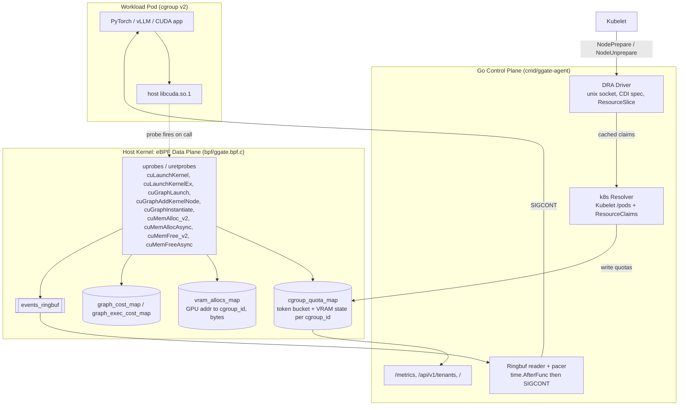
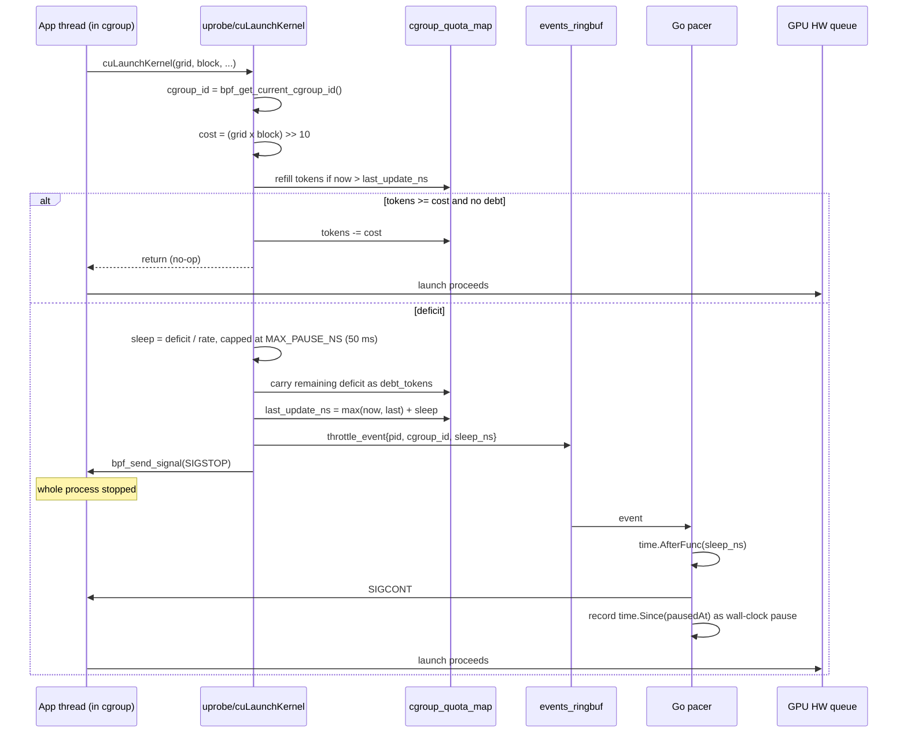
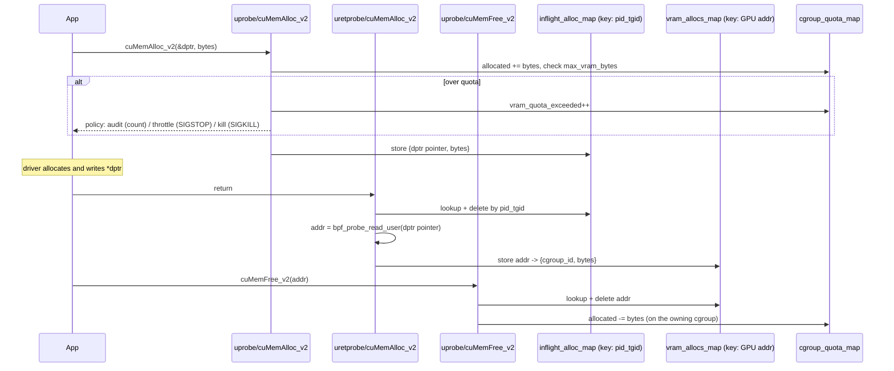
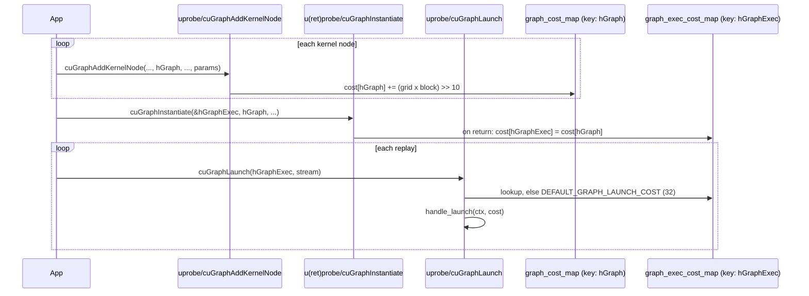
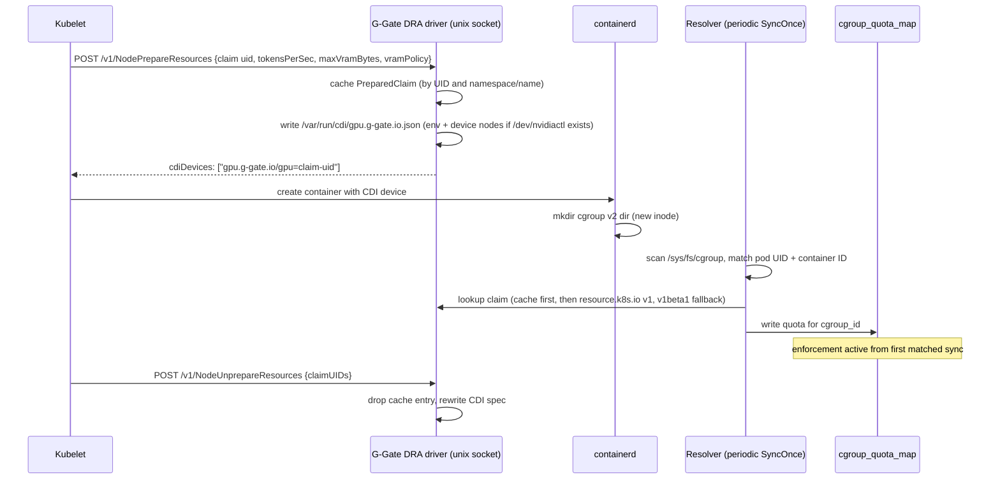

# G-Gate Architecture

This document explains how G-Gate works internally, focusing on the four mechanisms that are hard to follow from code alone. For usage, see the [README](../README.md). For measured results, see the [Validation Report](../benchmarks/VALIDATION_REPORT.md).

---

## 1. Component Overview

G-Gate has two halves: an **eBPF data plane** that runs in the host kernel and makes per-call decisions, and a **Go control plane** that programs quotas into BPF maps, resumes paused tasks, and exports metrics.

**Key property:** nothing is injected into the container. Probes attach to the host's `libcuda.so.1` inode, so every process mapping that library is covered, whatever image it runs.

---

## 2. Compute Throttling Loop

This is the core mechanism. A kernel launch is charged tokens before it reaches the GPU's hardware queue. When the cgroup is out of tokens, the calling thread is stopped in user space so it can't flood the queue and hurt co-tenants.

Design notes:

- **Why move `last_update_ns` into the future:** a paused process must not earn tokens during its own penalty. Refill only happens when `now > last_update_ns`, so the sleep pays the deficit off exactly once.
- **Why cap pauses and carry debt:** one huge deficit shouldn't freeze a process for seconds and trip Kubernetes liveness probes. The deficit is split into ≤50 ms slices and `debt_tokens` makes sure nothing is forgiven. (50 ms is the smallest cap that still paces a 128-token CUDA Graph at 6,400 tok/s, which needs a 20 ms gap between launches.)
- **Why SIGSTOP from the kernel but SIGCONT from Go:** `bpf_send_signal` acts synchronously on the current task. A timed resume needs a user-space timer.
- **Wall-clock accounting:** `ggate_gpu_throttled_seconds_total` uses the measured `time.Since(pausedAt)`, not the requested sleep, so scheduler latency is counted too.

---

## 3. VRAM Lifecycle Tracking

The CUDA Driver API makes this harder than it looks: `cuMemAlloc_v2(CUdeviceptr *dptr, size_t bytes)` returns the GPU address through an **output pointer**, and `cuMemFree_v2(CUdeviceptr dptr)` passes **only the address, not the size**. To credit memory back correctly, G-Gate remembers each allocation by address.

`cuMemAllocAsync` / `cuMemFreeAsync` go through the same path. On a real Tesla T4, freeing a 258 MiB PyTorch tensor reduced the tracked allocation by exactly 270,532,608 bytes, with zero drift.

Note that `kill` policy acts at the *entry* probe, before the driver commits memory, so the over-budget process dies before it can cause a device-wide OOM.

---

## 4. CUDA Graph Costing

A `cuGraphLaunch(hGraphExec, stream)` call carries no grid/block dimensions, because the graph was built earlier. G-Gate sums each node's cost while the graph is built and attaches the total to the executable handle.

Graphs captured by stream capture (`cuStreamBeginCapture`, which PyTorch's `torch.cuda.CUDAGraph` uses) don't go through `cuGraphAddKernelNode`, so they get the fallback cost of 32. Capture-path introspection is a known gap.

---

## 5. Kubernetes DRA Lifecycle Ordering

Kubelet calls `NodePrepareResources` **before** containerd creates the container's cgroup. That means no `cgroup_id` exists yet to bind a quota to. G-Gate solves this by caching the claim and binding it later.

Quota sources, in priority order: DRA `ResourceClaim` (cache or API), then Pod annotations (`g-gate.io/tokens-per-sec`, `g-gate.io/max-vram-mb`, `g-gate.io/vram-policy`), then static `--quota` flags.

---

## 6. Design Decisions and Known Limits

| Decision | Why | Trade-off |
| :--- | :--- | :--- |
| eBPF uprobes on host `libcuda.so.1` instead of `LD_PRELOAD` | No container mutation. Workloads can't bypass or tamper with it. Works with distroless images. | Requires root/`CAP_BPF` on the node and kernel BTF. |
| Throttle at **submission**, not execution | The GPU can't easily preempt queued work, so the only point where QoS can be enforced on non-MIG GPUs is before work enters the queue. | Can't preempt a kernel that is already running. |
| Cost proxy `(gridDim x blockDim) >> 10` | Cheap to compute in-kernel. Tracks real share well for framework workloads that launch many small kernels (99.57 to 99.98% on T4). | A deliberately pathological kernel (tiny grid, long runtime) is under-charged. |
| `SIGSTOP` the whole process | The only preemption primitive available synchronously from a uprobe. | Pauses all threads in the process, not just the launching thread. |
| Default graph cost 32 | Safe fallback when construction isn't observed. | Stream-captured graphs aren't costed by node yet. |
| Periodic resolver sync | Simple and robust to missed events. | Up to one sync interval between cgroup creation and enforcement. Unenrolled cgroups run unthrottled (attribution still works). |

### Out of scope (by design)

- **Hard SM or memory-bandwidth isolation.** Use MIG where hardware supports it.
- **Non-CUDA runtimes.** ROCm (`libamdhip64.so`) uses the same approach but isn't implemented.
- **Multi-GPU-per-process attribution.** Quotas are per cgroup, not per device.
